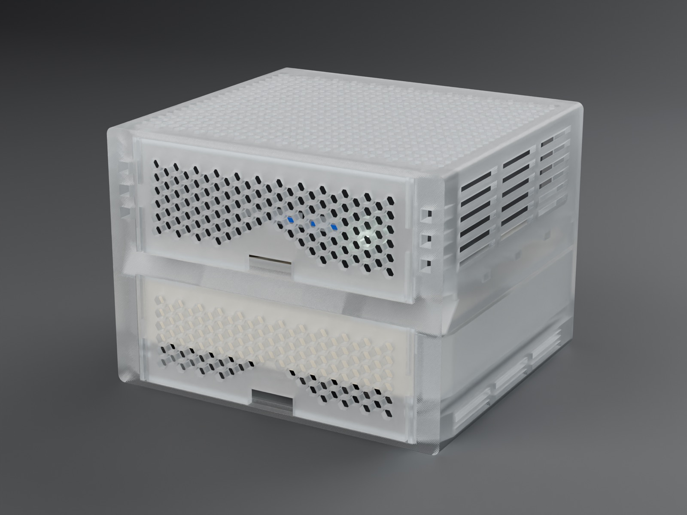
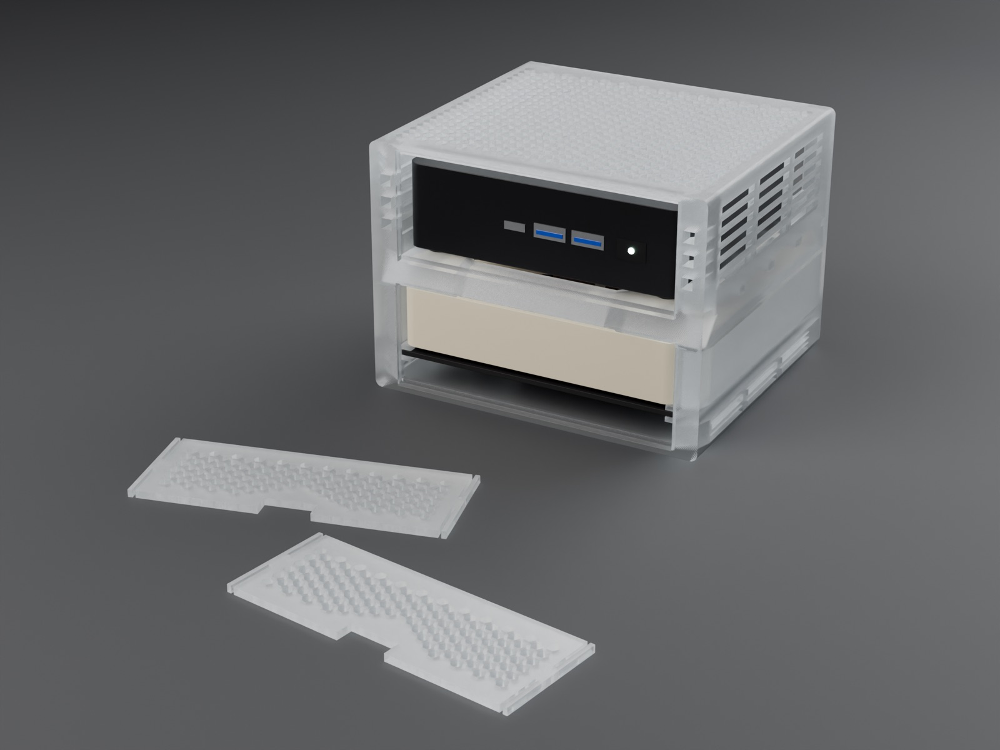
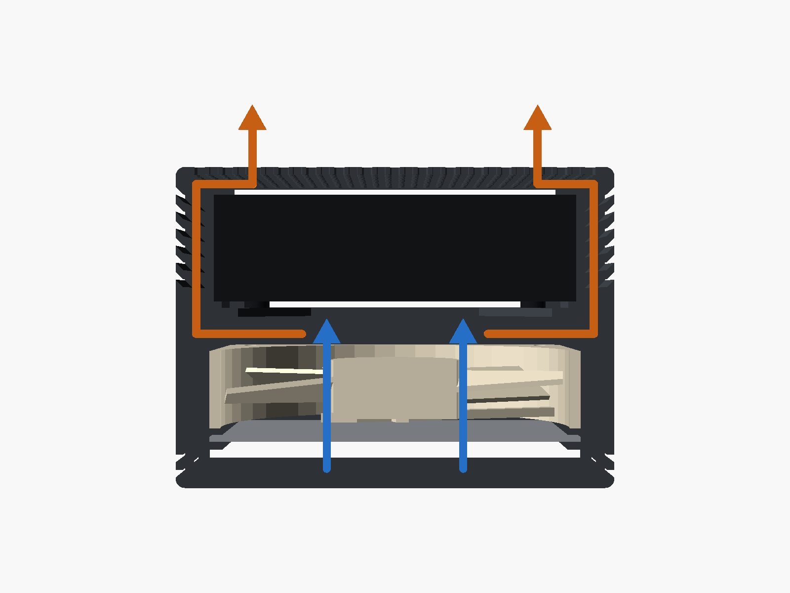
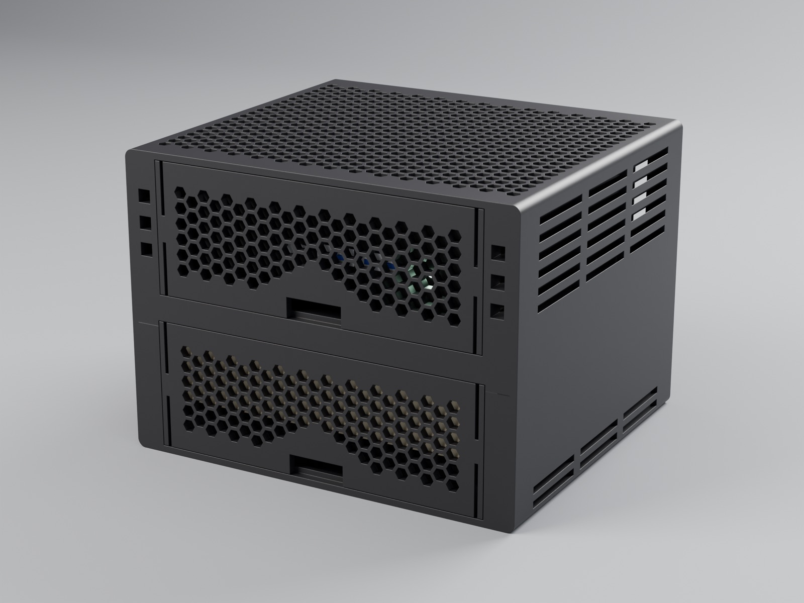
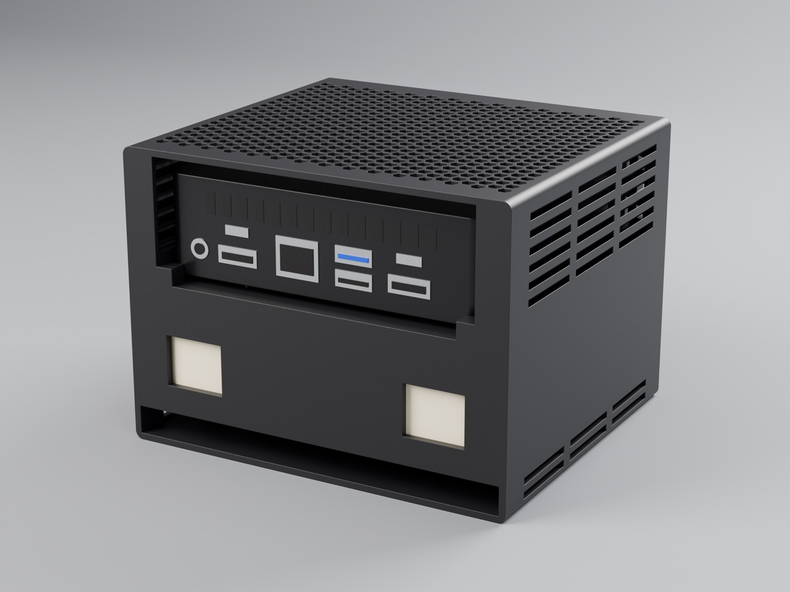
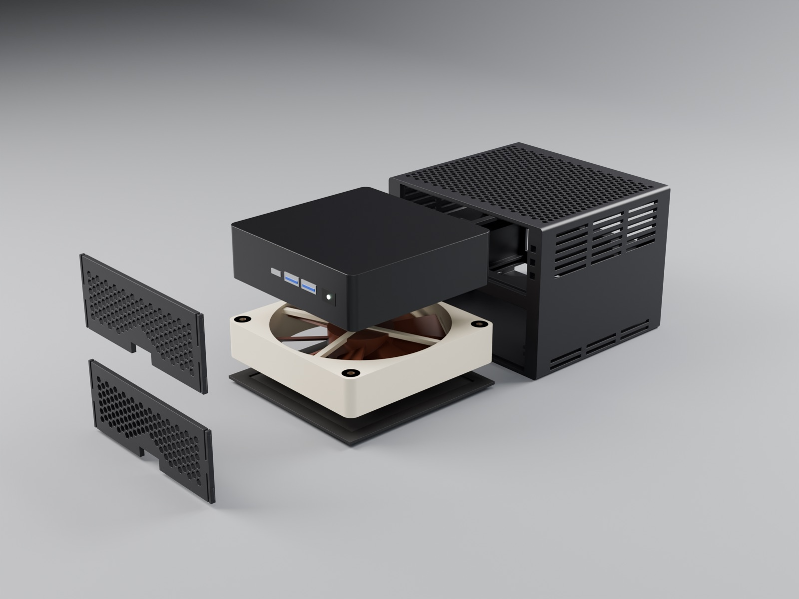
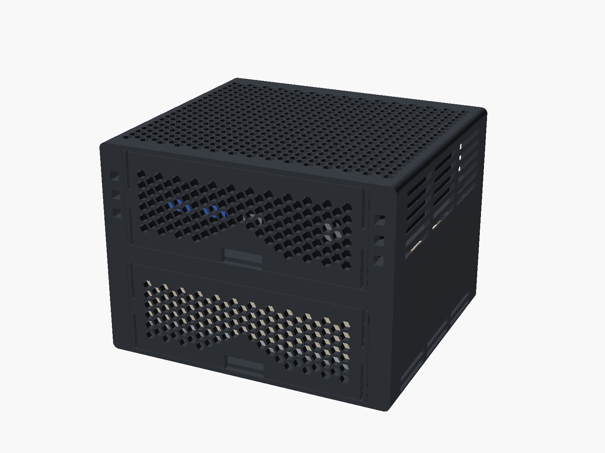

# NUC rack

A 3D-printed rack for the NUC behind this dashboard, an ASUS NUC 14 Pro slim
(117 × 112 × 37 mm). One 120 mm fan (Noctua NF-A12x25 5V PWM) sits underneath
and blows up; it is powered from one of the NUC's USB ports. Two mesh panels
click into the front. No supports, no screws.



Outer size: 141.8 × 126 × 103.7 mm (w × d × h).

Printed and test-fitted on 2026-11-14 in Bambu PETG Translucent on a Bambu Lab
P2S: the NUC, the fan, the dust filter and both panels fit.

## Parts

| File                | Qty | Print orientation         |
| ------------------- | --- | ------------------------- |
| `stl/body.stl`      | 1   | standing on its rear face |
| `stl/fan-panel.stl` | 1   | front face down           |
| `stl/nuc-panel.stl` | 1   | front face down           |

The STLs are already in print orientation. They need a bed of at least
145 × 110 mm and 126 mm of Z height.

Also needed: the fan, and optionally a flat 120 × 120 × 2 mm dust filter.

## Printing

Settings for Bambu Studio with a 0.4 mm nozzle, starting from `0.20mm Standard`:

| Setting                   | Value             |
| ------------------------- | ----------------- |
| Layer height              | 0.20 mm           |
| Wall loops                | 4, or 20 (below)  |
| Order of walls            | Inner/Outer/Inner |
| Seam position             | Aligned           |
| Thick bridges             | on                |
| Bridge speed              | 25 mm/s           |
| Outer wall speed          | 60 mm/s           |
| Sparse infill             | 15 % gyroid       |
| Supports, brim            | off               |

- The front bar of the NUC's seat is printed as a 61 mm bridge, the only one in
  the model. Slow, thick bridges give it the best chance.
- In a translucent filament the infill shows through the thick parts. 20 wall
  loops fill those with walls instead, so the whole case looks evenly frosted.
- Dry PETG before printing, or it strings in every hole of the mesh.
- On a textured PEI plate PETG needs no glue. The panels lie face down, so the
  plate surface is the surface you look at.

All three parts on one plate took about 15 hours and 258 g.

## Assembly

1. Pull the eight rubber anti-vibration pads off the fan. With them it is 27 mm
   thick and too grippy; the bay is made for the bare 120 × 120 × 25 mm frame.
2. Feed the fan cable through one of the two windows in the rear wall, then
   slide the fan into the lower bay from the front, label side up (it blows up).
3. Optional: slide the dust filter into the slot under the fan.
4. Push the fan panel into the front until it clicks. To remove it, hook a
   finger in the notch in its bottom edge and pull.
5. Slide the NUC in from the front until it hits the rear stops. It sits
   centred above the fan, a few mm in from the front and the rear.
6. Plug the fan's USB adapter into the NUC.
7. Click the NUC panel into the front. The front ports and the power button
   are behind it, pull the panel off to reach them.



## Airflow



The fan pulls air through the tunnel under it (slots in both side walls, mesh
panel at the front, open at the rear) and blows into the plenum under the NUC.
The NUC stands on a frame with a large opening, so the air hits its underside
first. From there it goes through the slots beside the NUC and up both of its
sides. Part of it leaves through the angled louvres in the side walls, the rest
goes over the lid and out of the top grille.

## Changing the design

`nuc-rack.scad` is a parametric [OpenSCAD](https://openscad.org) model; all
dimensions are parameters at the top. The ones most likely to need a tweak:

- `nuc_w`, `nuc_d`, `nuc_h` – size of the NUC
- `fan_clear`, `fan_t` – room around the fan
- `filter_slot` – height of the dust filter slot
- `seat_side`, `seat_bar`, `seat_corner` – shape of the opening under the NUC;
  the feet should land on the corner pads. A bigger `seat_corner` shortens the
  bridge of the front bar
- `panel_clear`, `bump`, `snap_preload` – fit of the panels, how hard they
  click and how firmly they are held
- `nuc_top_gap`, `tunnel_h` – air gap above the NUC and under the fan
- `louvre_n` – number of angled vents per side wall, `0` for none
- `top_fan_holes` – screw holes in the top grille for a second fan

```sh
./render.sh                  # stl/ and the preview images in renders/
./product/render.sh clear    # ray-traced product shots: black, white or clear
```

`render.sh` needs the snapshot build of OpenSCAD
(`brew install --cask openscad@snapshot`). `product/render.sh` also needs
[uv](https://docs.astral.sh/uv/); Blender's renderer comes in through uv as the
`bpy` package. Its output is full-size PNG and not committed; the `.jpg` files
in `renders/` are downscaled copies.

## More renders

| | |
| --- | --- |
|  |  |
|  |  |

The renders show the design, not a print: no layer lines, and the NUC, the fan
and the filter in them are rough stand-ins.
